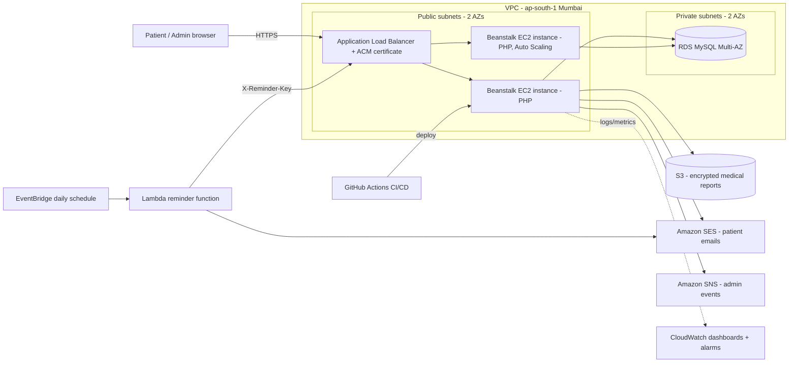

# Cloud Architecture

## Service choices & justification (use this in the report/viva)
| Need | Choice | Why |
|---|---|---|
| Service model | **PaaS** (Elastic Beanstalk) | Managed OS/patching, built-in load balancing, auto scaling and health checks; no need to manage servers |
| Deployment model | **Public cloud** (AWS) | Pay-as-you-go, no hospital data-centre cost, regional availability |
| Database | **RDS MySQL, Multi-AZ, private subnet** | Managed backups, automatic failover, not reachable from the internet |
| Files | **S3 + SSE-S3** | Durable, cheap, encrypted, pre-signed URLs expire in 5 min |
| Messaging | **SES + SNS** | Decouples notifications from the booking request |
| Reminders | **EventBridge + Lambda (serverless)** | Runs only once a day, costs almost nothing, event-driven |
| Scaling | **ALB + Auto Scaling (1–3)** | Handles morning booking rush, removes instances when idle |
| Monitoring | **CloudWatch** | Measurable evidence for performance/availability |
| Delivery | **GitHub Actions** | Automated, repeatable deployment (DevOps) |

Cost note: instances sit in public subnets restricted by security group (only the ALB can reach them) – this avoids the NAT Gateway cost (~₹3000/month) while the database stays private.
